<div align="center">

# 🚀 End-to-End CI/CD Pipeline

### Jenkins · Docker · GitHub · Docker Hub

Automatically **build, package, store, and deploy** a Node.js application every time code is pushed to GitHub.


</div>

---

## 📑 Table of Contents

- [Overview](#-overview)
- [Architecture](#-architecture)
- [Tech Stack](#-tech-stack)
- [Requirements](#-requirements)
- [Project Structure](#-project-structure)
- [Setup Guide](#-setup-guide)
- [The Jenkinsfile](#-the-jenkinsfile)
- [Running the Pipeline](#-running-the-pipeline)
- [Troubleshooting](#-troubleshooting)
- [Next Steps](#-next-steps)
- [What You Will Learn](#-what-you-will-learn)

---

## 📌 Overview

This project demonstrates a complete **Continuous Integration and Continuous Deployment (CI/CD)** workflow running entirely on a **local Ubuntu machine**.

When a developer pushes code to GitHub, Jenkins picks it up, builds a Docker image, pushes it to Docker Hub, and redeploys the running container, with no manual steps.

### Why build it locally instead of on AWS?

| | Benefit | Details |
|---|---|---|
| 💰 | **Zero cost** | No EC2, EBS, or data transfer charges |
| 🐞 | **Easy debugging** | Jenkins, Docker, and the app share one machine, so logs are all in one place |
| 🎯 | **Focused learning** | Concentrate on CI/CD concepts without VPCs, IAM, security groups, or DNS |
| ☁️ | **Cloud-ready** | The same pipeline migrates to EC2, Azure VM, GCP, or Kubernetes unchanged |

---

## 🏗 Architecture

```mermaid
flowchart LR
    A[👨‍💻 Developer] -->|git push| B[(GitHub)]
    B -->|checkout| C{{Jenkins Pipeline}}
    C --> D[🔨 Build Image]
    D --> E[🔐 Docker Login]
    E --> F[📦 Push to Docker Hub]
    F --> G[⬇️ Pull Latest Image]
    G --> H[🚢 Deploy Container]
    H --> I[🌐 Node.js App :3000]

    style C fill:#D24939,color:#fff
    style F fill:#2496ED,color:#fff
    style I fill:#339933,color:#fff
```



<details>
<summary>📝 Text version of the diagram</summary>

```
Developer → GitHub → Jenkins → Build Image → Docker Login
         → Push to Docker Hub → Pull Latest → Deploy Container → App Live
```

</details>

---

## 🧰 Tech Stack

| Component | Role |
|---|---|
| **GitHub** | Source code repository |
| **Jenkins** | CI/CD automation server |
| **Docker** | Containerization |
| **Docker Hub** | Container image registry |
| **Ubuntu (local)** | Build and deployment server |
| **Node.js + Express** | Sample application |

---

## 📋 Requirements

<table>
<tr>
<th>Hardware</th>
<th>Software</th>
</tr>
<tr>
<td>

**Minimum**
- 4 GB RAM
- 2 CPU cores
- 20 GB free disk

**Recommended**
- 8 GB RAM
- 4 CPU cores

</td>
<td>

- Ubuntu 22.04 LTS (or WSL2 with Ubuntu)
- Java 17
- Jenkins
- Docker
- Git
- Node.js
- GitHub account
- Docker Hub account

</td>
</tr>
</table>

---

## 📁 Project Structure

```
nodejs-cicd/
├── app.js            # Express application
├── package.json      # Dependencies and scripts
├── Dockerfile        # Container build instructions
├── Jenkinsfile       # Pipeline definition
├── .gitignore        # Excludes node_modules
├── .dockerignore     # Keeps the image small
└── README.md
```

---

## 🛠 Setup Guide

> 💡 Follow the steps in order. Each step includes a verification command.

### Step 1️⃣ Install Java

```bash
sudo apt update
sudo apt install openjdk-17-jdk -y
java -version
```

### Step 2️⃣ Install Jenkins

```bash
curl -fsSL https://pkg.jenkins.io/debian-stable/jenkins.io-2023.key | sudo tee /usr/share/keyrings/jenkins-keyring.asc > /dev/null
echo deb [signed-by=/usr/share/keyrings/jenkins-keyring.asc] https://pkg.jenkins.io/debian-stable binary/ | sudo tee /etc/apt/sources.list.d/jenkins.list > /dev/null
sudo apt update
sudo apt install jenkins -y
```

Start and verify:

```bash
sudo systemctl enable jenkins
sudo systemctl start jenkins
sudo systemctl status jenkins
```

Get the initial admin password:

```bash
sudo cat /var/lib/jenkins/secrets/initialAdminPassword
```

Open **http://localhost:8080** and install the **suggested plugins**.

📖 Official docs: https://www.jenkins.io/doc/book/installing/

### Step 3️⃣ Install Docker

```bash
sudo apt install docker.io -y
sudo systemctl enable docker
sudo systemctl start docker
docker --version
```

### Step 4️⃣ Give Jenkins access to Docker

```bash
sudo usermod -aG docker jenkins
sudo systemctl restart docker
sudo systemctl restart jenkins
groups jenkins
```

✅ Expected output: `jenkins : jenkins docker`

### Step 5️⃣ Install Git

```bash
sudo apt install git -y
git --version
```

Configure your identity:

```bash
git config --global user.name "Your Name"
git config --global user.email "you@example.com"
```

### Step 6️⃣ Create a Docker Hub repository

1. Create a free account at [hub.docker.com](https://hub.docker.com)
2. Create a repository named **`nodejs-cicd`**
3. Create an **access token**: *Account Settings → Security → New Access Token* (permissions: **Read, Write, Delete**)

> ⚠️ The token is shown **only once**. Copy it immediately.

### Step 7️⃣ Create the Node.js application

```bash
mkdir nodejs-cicd && cd nodejs-cicd
```

<details open>
<summary><b>📄 app.js</b></summary>

```javascript
const express = require('express');

const app = express();

app.get('/', (req, res) => {
    res.send('DevOps CI/CD Project Working');
});

app.listen(3000, () => {
    console.log('Running on port 3000');
});
```

</details>

<details open>
<summary><b>📄 package.json</b></summary>

```json
{
  "name": "nodejs-cicd",
  "version": "1.0.0",
  "scripts": {
    "start": "node app.js",
    "test": "echo Test Passed"
  },
  "dependencies": {
    "express": "^5.1.0"
  }
}
```

</details>

Install dependencies and test locally:

```bash
npm install
node app.js
```

### Step 8️⃣ Create the Dockerfile

```dockerfile
FROM node:20-alpine

WORKDIR /app

COPY package*.json ./
RUN npm install

COPY . .

EXPOSE 3000

CMD ["npm", "start"]
```

Add ignore files so `node_modules` never goes to Git or into the image:

```bash
echo "node_modules" > .gitignore
echo "node_modules" > .dockerignore
```

### Step 9️⃣ Push the code to GitHub

```bash
git init
git add .
git commit -m "Initial commit"
git branch -M main
git remote add origin YOUR_REPOSITORY_URL
git push -u origin main
```

> 🔑 When Git asks for credentials, enter your GitHub **username** as Username and a **Personal Access Token** as Password. Never paste the token in the Username field, and never commit it.

### Step 🔟 Install Jenkins plugins

Make sure these are installed (*Manage Jenkins → Plugins*):

- Pipeline
- Git
- Git Client
- Docker Pipeline
- Credentials Binding
- GitHub

### Step 1️⃣1️⃣ Add Docker Hub credentials in Jenkins

*Manage Jenkins → Credentials → System → Global credentials (unrestricted) → Add Credentials*

| Field | Value |
|---|---|
| **Kind** | Username with password |
| **Scope** | Global |
| **Username** | Your Docker Hub username |
| **Password** | Your Docker Hub **access token** |
| **ID** | `dockerhub` |

> ⚠️ The **ID** must be exactly `dockerhub` (case-sensitive). The Jenkinsfile looks it up by this name, and it cannot be edited after creation.

### Step 1️⃣2️⃣ Create the Jenkins pipeline job

*New Item → name it `NodeJS-CICD` → choose **Pipeline** → OK*

In the **Pipeline** section, choose **Pipeline script from SCM**, select **Git**, enter your repository URL, branch `*/main`, and script path `Jenkinsfile`. (Or paste the script directly using **Pipeline script**.)

---

## 📜 The Jenkinsfile

Create a `Jenkinsfile` in the project root:

```groovy
pipeline {

    agent any

    environment {
        IMAGE_NAME     = "YOUR_DOCKERHUB_USERNAME/nodejs-cicd"
        CONTAINER_NAME = "nodejs-app"
    }

    stages {

        stage('Checkout') {
            steps {
                git branch: 'main',
                    url: 'YOUR_GITHUB_REPOSITORY_URL'
            }
        }

        stage('Build Docker Image') {
            steps {
                sh 'docker build -t ${IMAGE_NAME}:latest .'
            }
        }

        stage('Docker Login') {
            steps {
                withCredentials([
                    usernamePassword(
                        credentialsId: 'dockerhub',
                        usernameVariable: 'DOCKER_USER',
                        passwordVariable: 'DOCKER_PASS'
                    )
                ]) {
                    sh 'echo "$DOCKER_PASS" | docker login -u "$DOCKER_USER" --password-stdin'
                }
            }
        }

        stage('Push Image') {
            steps {
                sh 'docker push ${IMAGE_NAME}:latest'
            }
        }

        stage('Deploy Container') {
            steps {
                sh '''
                docker rm -f ${CONTAINER_NAME} || true
                docker pull ${IMAGE_NAME}:latest
                docker run -d \
                    --name ${CONTAINER_NAME} \
                    -p 3000:3000 \
                    ${IMAGE_NAME}:latest
                '''
            }
        }
    }
}
```

### Pipeline stages at a glance

| # | Stage | What it does |
|---|---|---|
| 1 | 📥 **Checkout** | Clones the latest code from GitHub |
| 2 | 🔨 **Build Docker Image** | Builds `nodejs-cicd:latest` from the Dockerfile |
| 3 | 🔐 **Docker Login** | Authenticates to Docker Hub using the stored credential |
| 4 | 📦 **Push Image** | Uploads the image to Docker Hub |
| 5 | 🚢 **Deploy Container** | Removes the old container, pulls the new image, starts it on port 3000 |

> 💡 `docker rm -f ... || true` makes the deploy step safe to re-run, even when no old container exists.

---

## ▶️ Running the Pipeline

1. Open your job in Jenkins and click **Build Now**.
2. Watch **Console Output**. A successful run ends with `Finished: SUCCESS`.

### ✅ Verify the deployment

```bash
docker ps                  # container "nodejs-app" should be Up
docker logs nodejs-app     # should print: Running on port 3000
docker images              # your image should be listed
```

Open **http://localhost:3000** and you should see:

```
DevOps CI/CD Project Working
```

---

## 🩺 Troubleshooting

<details>
<summary><b>❌ <code>Could not find credentials entry with ID 'dockerhub'</code></b></summary>

Jenkins has no credential with that exact ID.

- Check the **ID** column in *Manage Jenkins → Credentials* (not the Name).
- IDs are case-sensitive; `DockerHub` ≠ `dockerhub`.
- The credential must be in the **Global** scope, not a user or folder scope.
- The ID can't be edited. Delete and recreate it with ID `dockerhub`.

</details>

<details>
<summary><b>❌ <code>Author identity unknown</code> when committing</b></summary>

```bash
git config --global user.name "Your Name"
git config --global user.email "you@example.com"
```

</details>

<details>
<summary><b>❌ Container exits immediately (<code>docker ps</code> is empty)</b></summary>

`docker ps` shows only running containers. Check what happened:

```bash
docker ps -a
docker logs nodejs-app
```

Typical causes: a syntax error in `app.js` (for example duplicated code causing `Identifier 'express' has already been declared`), a wrong entry file name in `package.json`, or a missing `CMD` in the Dockerfile.

</details>

<details>
<summary><b>❌ <code>container name "/nodejs-app" is already in use</code></b></summary>

```bash
docker rm -f nodejs-app
```

The Jenkinsfile above already does this automatically before each deploy.

</details>

<details>
<summary><b>❌ <code>Cannot find module 'express'</code> when running locally</b></summary>

Dependencies aren't installed on your machine yet:

```bash
npm install
```

</details>

<details>
<summary><b>❌ <code>permission denied</code> when Jenkins runs Docker</b></summary>

```bash
sudo usermod -aG docker jenkins
sudo systemctl restart jenkins
```

</details>

<details>
<summary><b>❌ <code>git push</code> keeps asking for a password</b></summary>

Use your GitHub username and a Personal Access Token (not your account password). To remember it:

```bash
git config --global credential.helper store
```

</details>

---

## 🔭 Next Steps

- [ ] Add a **Test** stage (`npm test`) before the build, so broken code never reaches Docker Hub
- [ ] Tag images with the build number (`${IMAGE_NAME}:${BUILD_NUMBER}`) to allow rollbacks
- [ ] Trigger builds automatically with a **GitHub webhook** or **Poll SCM**
- [ ] Add **notifications** (email or Slack) on build failure
- [ ] Scan images for vulnerabilities (for example with Trivy)
- [ ] Deploy to a cloud VM or a Kubernetes cluster

---

## 🎓 What You Will Learn

- ✅ CI/CD fundamentals
- ✅ Jenkins pipeline creation
- ✅ Docker image creation
- ✅ Docker Hub integration
- ✅ Automated deployment
- ✅ GitHub integration
- ✅ Container lifecycle management
- ✅ A real-world DevOps workflow

---

<div align="center">

**Built as a hands-on DevOps learning project** 🛠️

If this helped you, consider giving the repo a ⭐

</div>
